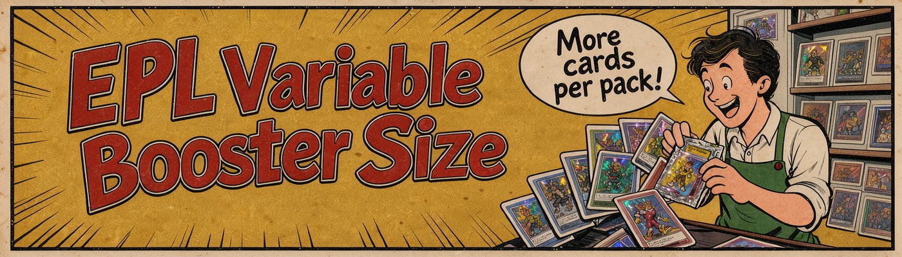

# EPL Variable Booster Size



An extension for Enhanced Prefab Loader (EPL): card packs
of custom card sets can hold **more than 7 cards**. Pack your boosters like the real ones (11 cards for an old set,
10 for a modern one) with a rarity table for every card slot, and open them in the game as usual.

> **AI-made.** This mod was written by an AI (Claude). I'm a developer, but I did not review its code: I made it
> simply to be able to play and enjoy the game. It is shared as is; use it at your own risk.

## What it does

EPL builds a pack from "slots": `Slot1` to `Slot7`, each with the chances of every rarity. Seven is its limit, and the
game's pack opening is made for 7 cards too. This mod lifts both limits, for the packs that ask for it:

- **Any number of slots**: `Slot8`, `Slot9` and so on, or ranges such as `Slot1-5`. One card is drawn per slot, with
  the slot's rarity chances, like EPL's own packs (no duplicate in a pack unless the pack allows it).
- **The pack opening shows every card**: the same card by card reveal as the game, going on to the last card, then all
  the cards on the final screen, on **two rows** (the top row gets the extra card of an odd count).
- **Fitted to your screen**: the final screen is laid out with your camera, whatever the resolution or the screen
  shape (16:9, 16:10, 21:9...). The cards get smaller only when the rows would not fit.
- **Only those packs change**: packs of 7 cards or fewer (vanilla packs and every other EPL pack) open exactly as
  before, with the game's own final screen.
- The card sets' own card backs, foils and holo effects are kept: EPL still makes every card.
- The auto pack opener goes through EPL's pack generation, so it gets all the cards of the pack too.

**On its own, this mod adds no card to any pack.** Bigger packs need more than 7 slots, given by a card set mod or by you
in a small file (see below).

## Giving a pack more cards

### In a card set mod (for set authors)

Write the extra slots in the pack's `SlotWeights`, in the EPL JSON of the set:

```json
"SlotWeights": {
  "Slot1-7":  { "Common": 100 },
  "Slot8-10": { "Uncommon": 100 },
  "Slot11":   { "Rare": 70, "Holo Rare": 30 }
}
```

Keys: `SlotN`, ranges `SlotA-B`, or lists `Slot1, Slot2`. Rarity names are the set's own (as in its `Rarities` list).
Without this mod installed, EPL refuses a pack with slots it does not know: tell your players this mod is needed.

### For a pack of another mod (players, patches)

To change a pack without editing its mod, add a file named `<anything>.packslots.json` anywhere under
`BepInEx/plugins` (for example `BepInEx/plugins/EPLVariableBoosterSize/my-packs.packslots.json`). Each entry is the
pack's `ItemType` (as written in its set's EPL JSON) and its slots:

```json
{
  "_doc": "Scarlet & Violet booster of the MyCurio sets as 10 cards.",
  "sviPack": {
    "SlotWeights": {
      "Slot1-4": { "Common ": 100 },
      "Slot5-7": { "Uncommon ": 100 },
      "Slot8":   { "Common Reverse Holofoil": 49.3, "Uncommon Reverse Holofoil": 28.2, "Rare Reverse Holofoil": 9.9 },
      "Slot9":   { "Common Reverse Holofoil": 49.3, "Illustration Rare": 5.6, "Special Illustration Rare": 2.2, "Hyper Rare": 1.9 },
      "Slot10":  { "Rare Holofoil": 79.7, "Double Rare": 13.8, "Ultra Rare": 6.6 }
    }
  }
}
```

- Weights are relative chances inside a slot (they do not need to add up to 100).
- `"CanHaveDuplicates": true` next to `SlotWeights` allows the same card twice in a pack (default: the pack's own
  setting).
- A file entry wins over the slots written in the set's own JSON. Keys starting with `_` are comments.
- The files are read when the game starts. The log (`BepInEx/LogOutput.log`) lists every pack it changed, and says
  why when it skips one (unknown pack, unknown rarity, missing slot).

## Limits

- **God packs** keep EPL's own generation (7 cards).
- More cards per pack is more value per pack: the pack's price is still the one set by its mod.

## Installation

1. Install [BepInEx 5.4.23](https://github.com/BepInEx/BepInEx/releases) and Enhanced Prefab Loader (version 6.8.0).
2. Put `EPLVariableBoosterSize.dll` in `BepInEx/plugins/EPLVariableBoosterSize/`.

## Configuration

`BepInEx/config/gab.tcgshop.eplvariableboostersize.cfg` (also editable in game with the Configuration Manager; the
next pack opened uses the new values).

| Section | Setting | Default | |
|---|---|---|---|
| Pack opening | `CardScale` | 0.75 | Size of the cards on the final screen of a pack of more than 7 cards (1 = the game's size). Smaller on its own if the rows do not fit the screen. |
| | `RowSpacing` | 0.73 | Distance between the middles of the two rows, in card heights. Under 1, the bottom row covers the foot of the top one. |

## Compatibility

- Another mod that rewrites the game's pack opening screen for every pack may conflict; the log warns if the
  opening could not be patched.

## Build

```bash
dotnet build -c Release
```

If the game is not in `D:\Games\TCG Card Shop Simulator`, add `-p:GameDir="C:\path\to\the\game"`. Requires the .NET SDK
8 or newer. `-p:Deploy=true` copies the DLL and its symbols to `BepInEx/scripts/EPLVariableBoosterSize/` for
[ScriptEngine](https://github.com/BepInEx/BepInEx.Debug) hot reload (the mod removes its patches when unloaded). Packs
written in a set's own EPL JSON are only read at game start: test those with a full restart.
